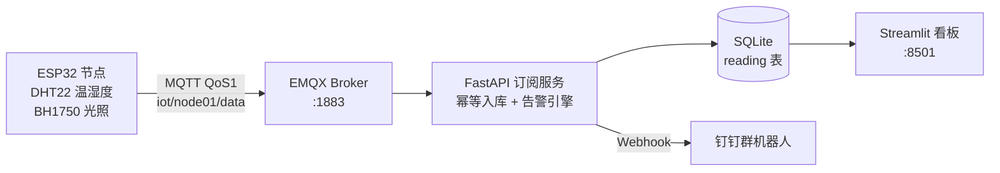

# 环境监测与远程告警系统（ESP32 + MQTT + FastAPI + SQLite + Streamlit）

> 用不到 150 元，把「人工一天看两次」变成「10 秒一采、越限 5 秒告警、数据可回溯」。

状态：🚧 开发中（阶段 0）

## 1. 背景：要解决什么问题

（待填：真实场地 + 痛点 + 量化。写完把 docs/需求说明.md 的链接放这里）

## 2. 系统架构



（待填：先手绘一版拍照放 docs/img/，再用上面的 mermaid 复刻；两张都留 —— 手绘证明想清楚了）

## 3. 快速开始

（待填：起 broker → 起后端 → 起看板 → 烧固件，四步，每步一条命令 + 预期输出）

## 4. 指标实测

九项指标与测量方法见 [docs/验收数据.md](docs/验收数据.md)。（待填：最终填完把最亮的三个数写在这）

## 5. 踩坑记录

断网丢数 / 时间戳错乱 / 重复消息 —— 详见 [docs/踩坑记录.md](docs/踩坑记录.md)。（待填）

## 目录结构

```
env-monitor/
├── firmware/esp32_node/     ESP32 固件（Arduino）
├── server/                  FastAPI + MQTT 订阅 + SQLite + 告警
├── dashboard/               Streamlit 看板
├── scripts/                 模拟器 / 指标统计
└── docs/                    需求说明 / 验收数据 / 踩坑记录 / 运维日志 / 图
```
