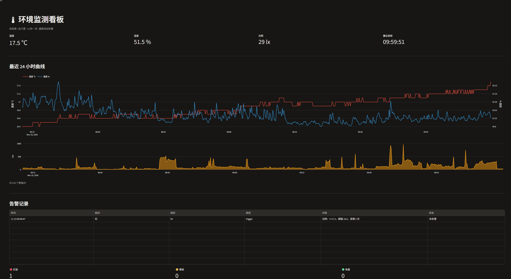
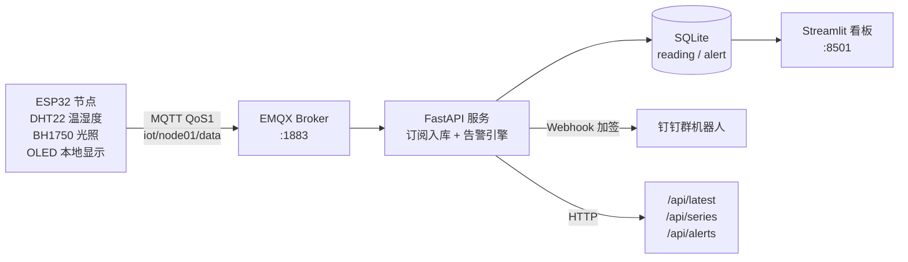
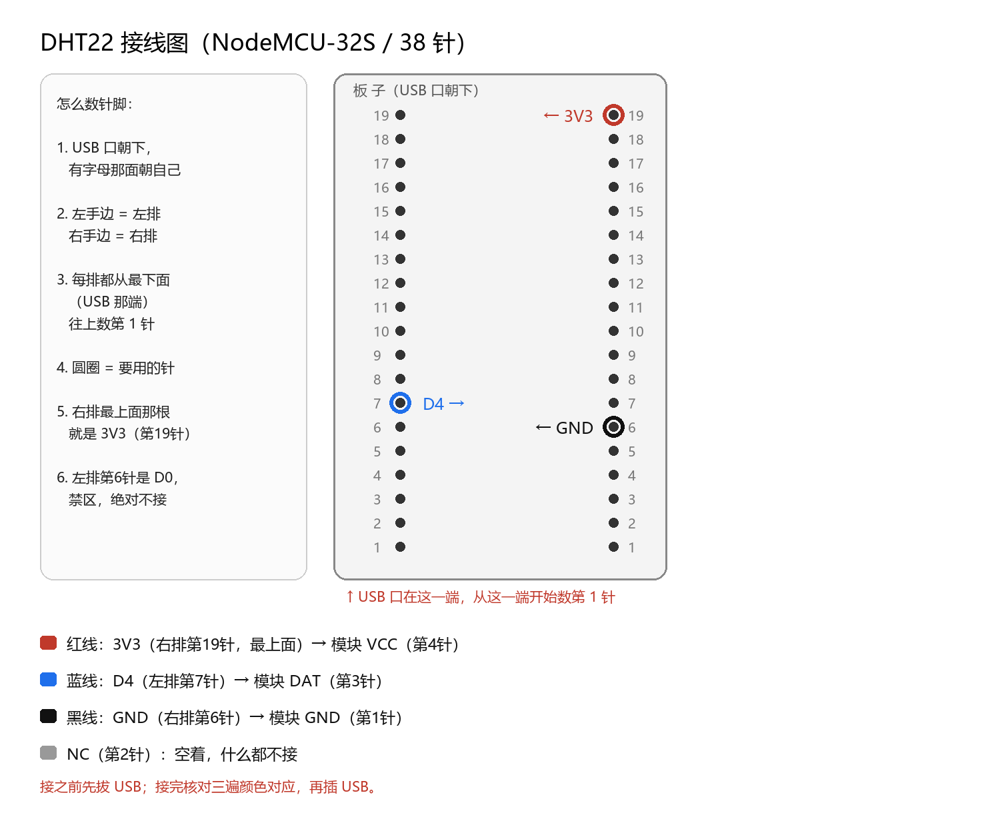
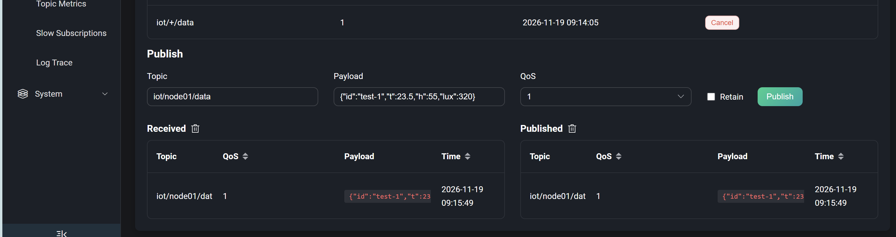

# 环境监测与远程告警系统（ESP32 + MQTT + FastAPI + SQLite + Streamlit）

> 用 **78 元** 的单节点成本，把「人工一天看两次」变成「10 秒一采、越限自动告警、数据可回溯」。



一个能真正放下跑的物联网闭环：设备采集 → MQTT 上报 → 幂等入库 → 规则判定 → 钉钉推送 → 网页看板。
核心不是"能采到数据"，而是**断网不丢、重复不脏、夜里没人也管得住**。

## 1. 背景：要解决什么问题

场景是学院的实验室 / 自习室。三类浪费长期存在，而且**都发生在没人的时候**：

| 现象 | 后果 | 现状 |
|---|---|---|
| 空调忘了关，整夜制冷 | 电费白烧，设备长期受潮 | 靠人记得关 |
| 设备柜 / 机柜积热 | 元器件寿命骤降，严重时损坏 | 柜内没有温度计 |
| 灯亮一整夜 | 浪费电，也说明管理缺位 | 靠保安巡楼 |

现在的做法是**人工一天看两次**，这意味着任何一个越限事件，平均要被忽略 4 小时以上。

所以本项目的目标很具体：**在无人值守的夜里，系统必须自己判断、自己告警；有人在的白天，系统只做助手给建议，由人决定。**

> 完整需求与 5 条规则的阈值依据见 [docs/需求说明.md](docs/需求说明.md)。

## 2. 系统架构



**五个设计点**（都能单独替换：换 broker 不用动固件，换看板不用动服务）：

1. **主题约定** `iot/{node_id}/data`，服务端用通配符 `iot/+/data` 订阅 —— 一个订阅接所有节点，真机和模拟器可以同时挂。
2. **双时间戳**：`ts` 是设备 NTP 校时后的采集时刻（业务用），`recv_ts` 是服务端接收时刻（排障 / 算延迟用）。
3. **幂等做在存储层**：`msg_id`（设备侧 uuid4）作主键 + `INSERT OR IGNORE`，QoS1 的重复投递不会脏数据。
4. **两层兜底**：设备侧 200 条环形缓冲（管设备断网）+ broker 离线队列（`clean_session=False`，管后端重启）。
5. **规则与逻辑分离**：5 条规则写在 `alerts.py` 的 `RULES` 表里（阈值 / 连续条数 / 生效时段 / 级别），新增一条只加一行配置。

### 2.1 硬件接线

| 器件 | 接口 | 说明 |
|---|---|---|
| ESP32-WROOM-32E（NodeMCU-32S，38 针） | — | CH340 USB 串口 |
| DHT22 温湿度 | D4 | 数字单总线，10 秒一采（模块最快 2 秒） |
| BH1750 光照 | I2C（SDA=D21, SCL=D22, 地址 0x23） | 1–65535 lux |
| SSD1306 OLED 0.96" | I2C（同总线，地址 0x3C） | 本地显示温湿度 / 状态 / 缓存条数 |
| 有源蜂鸣器 | D25 | 本地过热兜底（断网时云端判不了） |
| LED 红 / 绿 | D27 / D26 | 告警状态指示 |



详细的针脚、面包板电源轨、自检清单与故障对照见 [docs/接线说明.md](docs/接线说明.md)。

### 2.2 链路验证：先验证协议，再接硬件

动硬件之前，先用 EMQX 自带的 WebSocket 客户端验证主题与 QoS：订阅 `iot/+/data`、发布 `iot/node01/data`（QoS 1），
收发两侧都出现同一条消息 —— 「单节点上报 + 通配符订阅」这套约定成立，后面固件和模拟器都按它来。



## 3. 快速开始

环境：Windows 11 / Python 3.13 / Arduino IDE 2.3.11 / EMQX 5.0.26。
依赖版本已锁定在 [requirements.txt](requirements.txt)。

```powershell
# 0. 装依赖
python -m venv .venv
.\.venv\Scripts\python.exe -m pip install -r requirements.txt
```

```powershell
# 1. 起 MQTT broker（EMQX，需先下载解压）
cd D:\develop\emqx\bin
.\emqx.cmd start
.\emqx_ctl.cmd status          # 期望：Node 'emqx@127.0.0.1' 5.0.26 is started
```

```powershell
# 2. 起后端（订阅 + 入库 + 告警 + HTTP 接口）
cd <项目根目录>
.\.venv\Scripts\python.exe -m uvicorn main:app --app-dir server --host 127.0.0.1 --port 8000
# 期望：Uvicorn running on http://127.0.0.1:8000
#       [mqtt] subscribed iot/+/data
```

```powershell
# 3. 起看板
.\.venv\Scripts\python.exe -m streamlit run dashboard\app.py
# 期望：Local URL: http://localhost:8501
```

```powershell
# 4. 烧固件
# 复制 firmware/esp32_node/secrets.example.h → secrets.h，填入 WiFi 与 broker 地址
# Arduino IDE 打开 firmware/esp32_node/esp32_node.ino → 选板 "ESP32 Dev Module" → 上传
# 期望串口：WiFi 连上 → NTP 对时 → PUB OK {"id":"...","ts":"...","t":17.6,...}
```

**5. 验证**

| 检查 | 预期 |
|---|---|
| 后端控制台 | 每 10 秒一行 `[NEW] node01 t=.. h=.. lux=..` |
| `http://127.0.0.1:8000/docs` | Swagger 列出 5 个接口 |
| `http://127.0.0.1:8000/api/latest` | 返回最新一条读数 |
| 看板 | 四个卡片有数、曲线在增长 |

> 用树莓派 / 另一台电脑演示时，把 `secrets.h` 里的 `MQTT_HOST` 改成 broker 所在机器的局域网 IP 即可。

## 4. 指标实测

九项验收指标与测量方法见 [docs/验收数据.md](docs/验收数据.md)。**最关键的三个数**：

| 指标 | 目标 | 实测 | 怎么测的 |
|---|---|---|---|
| **消息丢失率** | < 0.5% | **0.000%**（5 节点并发 30 分钟，发 900 收 900） | `scripts/simulate.py` → `scripts/metrics.py` |
| **重复入库率** | 0 | **0.0000** | `COUNT(*)` vs `COUNT(DISTINCT msg_id)` |
| **端到端 P95 延迟** | < 2 s | **0.517 s**（真机，扣除 −1.42 s 时钟偏移后） | `recv_ts − ts` 取 95 分位 |

其余实测：

| 项 | 结果 |
|---|---|
| 断网补传 | 关热点 120 秒 → 缓冲 12 条 → 恢复后 2 秒内重连并补发，**12/12 入库、零重复** |
| 告警送达时延 | 规则成立 → 钉钉 API 返回成功 **311 ms** |
| 10 万条查询 | 窄时间窗 **13.2 ms → 0.4 ms（33.2 倍）**；全表聚合反而 11.1 → 14.5 ms（反例，见验收数据） |
| 单节点成本 | **78.00 元**（核心 BOM 不含 OLED 为 61.48 元） |
| 连续运行 | 7×24 运行第 1 天开始（2026-11-24 06:55 起），每日记录见 [docs/运维日志.md](docs/运维日志.md) |

**一个方法论上的坑（我认为比数字更重要）**：
一开始端到端延迟算出来是**负数**（−0.44 s），因为设备和服务器的时钟有偏差。后来把固件时间戳精确到毫秒、
并用**中位数法先把时钟偏移扣掉**再算 P95，数字才有意义。**测量精度不能低于被测指标的量级。**

## 5. 踩坑记录

完整 17 条（现象 / 排查 / 根因 / 解法 / 一句话）见 [docs/踩坑记录.md](docs/踩坑记录.md)。挑三个最能说明问题的：

### ① Arduino 数据目录做 Junction，板子列表全空

为了省 C 盘，把 Arduino15 目录做成符号链接挪到 D 盘。装完驱动后**开发板列表变空**，IDE 里没有任何报错信息。
绕过 IDE 直接调 `arduino-cli board listall` 才拿到真实原因：**arduino-cli 不跟随符号链接**。
最终改用环境变量 `ARDUINO_DIRECTORIES_DATA` / `ARDUINO_DIRECTORIES_USER` 指向 D 盘。
→ **省空间换来 IDE 不可用，不划算。**

### ② `WiFi.reconnect()` 靠不住，热点重开后永远连不回来

关掉手机热点再打开，板子一直打印 `[WiFi] lost`，几分钟都不恢复。
排除热点、排除 MQTT 后定位到 `reconnect()` 本身。改成 `disconnect()` + 100 ms + `begin()`，并按 10 秒限流。
→ **实测 2 秒恢复，缓冲归零。看起来该管用的 API 可能只是薄封装。**

### ③ SQLite 连接跨线程，后端跑着跑着就崩

报 `SQLite objects created in a thread can only be used in that same thread`。
第一次修复（在 `start_mqtt()` 里建连接）失败——因为 paho 的 `loop_start()` 会另起线程。
最终用 `threading.local()` 做线程本地连接，HTTP 侧用每请求一个连接。
→ **同一个进程里，回调线程和主线程不是一回事。**

## 6. 已知局限（主动交代）

| 局限 | 说明 |
|---|---|
| 没有人体存在检测 | 用「无人时段 22:30–07:00 + 临时延长」替代；时段外有人使用时依赖人工延长 |
| 判不出「空调是否在运行」 | 温度只反映结果，不是原因；要直接判断需要电流互感器或红外码 |
| 光照只覆盖传感器视野内 | 实测：室内主灯全开 92.5 lux，但只开房间一侧的单灯时仍是 0.8 lux（灯不在视野内）→ 该场景会漏报 |
| 断电不可恢复 | 环形缓冲在 RAM，断电即丢；本版未做持久化（NVS / SPIFFS） |
| 单节点 | 扩展性用 `simulate.py` 模拟 5 节点验证，未做真实多节点部署 |
| 依赖手机热点 | 校园网每晚 23:00 断网 + Portal 认证 + AP 隔离，不可用；ESP32 也不支持 5GHz |
| 部署场地 | 硬件部署在同构的宿舍环境做 7×24 验证，规则按实验室场景设计 |

## 7. 目录结构

```
env-monitor/
├── firmware/
│   ├── esp32_node/          正式固件（传感器 + 缓冲 + LED/蜂鸣器 + OLED）
│   └── bringup/             4 个 bring-up 程序（自检 / DHT22 / BH1750 / 合并）
├── server/                  FastAPI + MQTT 订阅 + SQLite + 告警引擎 + 钉钉推送
├── dashboard/               Streamlit 看板
├── scripts/                 模拟器 / 指标统计 / 索引对比 / 基线快照
├── tests/                   告警引擎单元测试（13 条）
└── docs/                    需求说明 / 接线说明 / 验收数据 / 踩坑记录 / 运维日志 / 图
```

## 8. 相关文档

- [需求说明](docs/需求说明.md)：5 条规则的阈值依据、双时段设计、与实施手册的偏差
- [接线说明](docs/接线说明.md)：针脚表、自检清单、故障对照
- [验收数据](docs/验收数据.md)：9+2 项指标的测量方法与实测值
- [踩坑记录](docs/踩坑记录.md)：17 条问题复盘
- [运维日志](docs/运维日志.md)：7×24 运行记录
